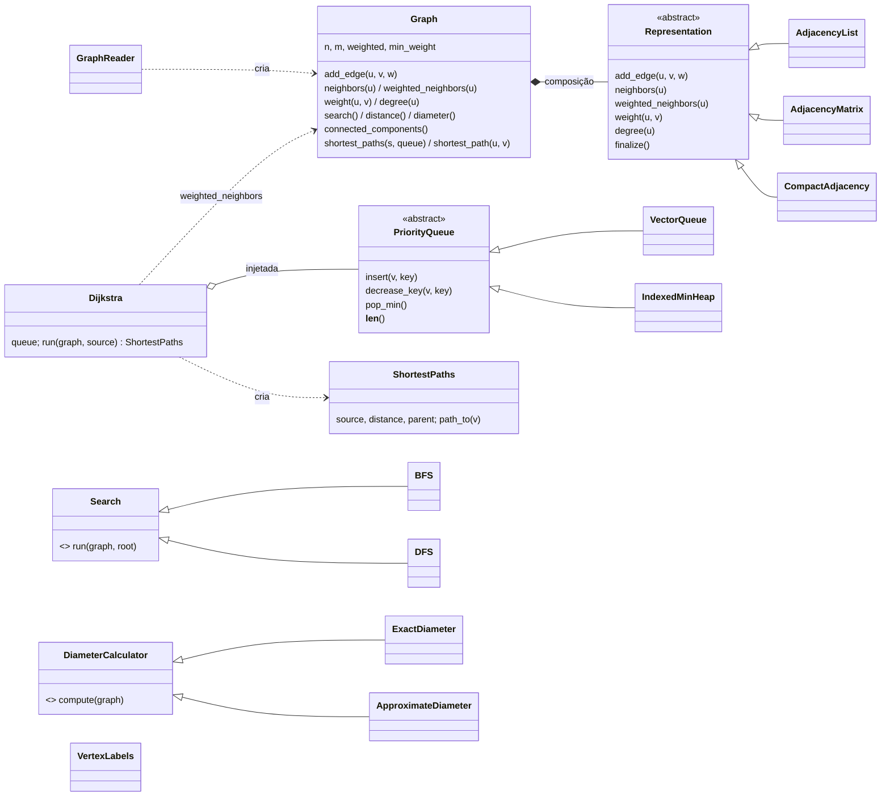
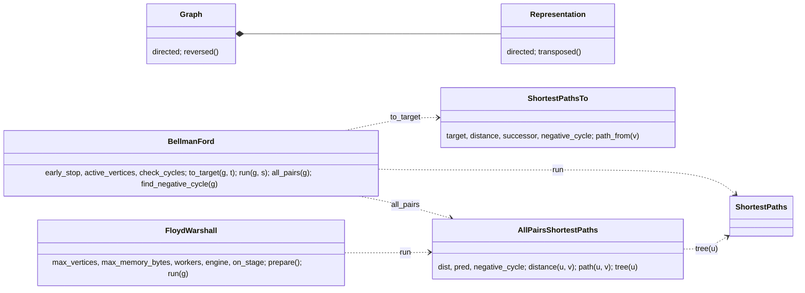

# Arquitetura da biblioteca (Partes 1, 2 e 3)

## Visão geral



| Camada | Arquivos |
|---|---|
| Domínio | `graphs/graph.py`, `graphs/representations.py` |
| Algoritmos | `search.py`, `components.py`, `diameter.py`, `priority_queues.py`, `shortest_paths.py`, `bellman_ford.py`, `floyd_warshall.py` |
| Entrada e saída | `graphs/graph_io.py` (`GraphReader`, `VertexLabels`, `ReportWriter`) |
| Experimentos | `experiments/part3/` (Parte 3), `experiments/` (Parte 2), `case_study.py` e `run_all.py` (Parte 1) |
| Testes | `tests/` (`unittest`, sem dependências) |

## 1. Como a biblioteca foi estendida

Nenhuma classe da Parte 1 foi substituída. A Parte 2 acrescenta:

- **`Representation`** ganhou `weighted_neighbors(u)` e `weight(u, v)`, e `add_edge` recebe um peso
  opcional. Uma representação sem pesos devolve peso 1,0, então todos os algoritmos novos também
  rodam nos grafos da Parte 1, e os algoritmos antigos (BFS, DFS, componentes, diâmetro) rodam nos
  grafos ponderados sem mudança, porque só usam `neighbors`.
- **`Graph`** ganhou o argumento `weighted`, o mínimo dos pesos (`min_weight`, calculado durante a
  carga, o que deixa a checagem de pesos negativos em O(1)) e os atalhos `shortest_paths` e
  `shortest_path`, como os atalhos já existentes `search` e `diameter`.
- **`CompactAdjacency`** (`"csr"`) é uma terceira representação, escolhida pela mesma fábrica
  `create_representation`.
- **`priority_queues.py` e `shortest_paths.py`** são módulos novos de algoritmo.
- **`GraphReader.read`** detecta a 3ª coluna; **`VertexLabels`** lê o arquivo de nomes.

Compatibilidade: as assinaturas antigas continuam válidas (`Graph(n, edges, representation)`,
`GraphReader.read(path, representation)`, `add_edge(u, v)`). A única mudança de comportamento é que
`add_edge` agora rejeita vértices fora de 1..n com `ValueError`; antes isso causava `IndexError` ou
corrompia a matriz. Os testes de regressão da Parte 1 (`tests/test_part1_regression.py`) rodam nas
três representações.

## 2. Por que essas abstrações

- **Representação por composição.** Dijkstra, BFS e as componentes só pedem vizinhos a `Graph`.
  Trocar lista por CSR não muda nenhuma linha dos algoritmos, e foi isso que permitiu carregar o
  grafo de 50 milhões de vértices sem reescrever nada.
- **Fila de prioridade por injeção.** O enunciado pede para "não implementar o algoritmo duas vezes".
  O que muda entre as duas versões é só onde ficam as estimativas e como o mínimo é extraído. Isso
  é exatamente a interface `PriorityQueue` (`insert`, `decrease_key`, `pop_min`, `len`).
  `Dijkstra(VectorQueue)` e `Dijkstra(IndexedMinHeap)` executam o mesmo laço de relaxamento e a
  mesma reconstrução de caminhos, então uma correção no núcleo vale para as duas, e o benchmark
  compara só a fila.
- **Resultado como objeto (`ShortestPaths`).** Uma execução a partir da origem responde a todos os
  destinos (`distance_to`, `path_to`, `reachable`), sem recalcular Dijkstra por destino.

## 3. Grafos ponderados

| Representação | Memória | Vizinhos com peso | `weight(u, v)` | Uso indicado |
|---|---|---|---|---|
| `list` | um `array('i')` e um `array('d')` por vértice; O(n + m) | O(grau) | O(log grau), busca binária na linha ordenada | grafos médios (rede de colaboração) |
| `matrix` | n² bytes + 8n² bytes de pesos | O(n) por vértice | O(1) | grafos pequenos e densos |
| `csr` | 3 arrays planos: offsets (8 B/vértice), alvos (4 B/entrada), pesos (8 B/entrada) | O(grau), fatias contíguas | O(grau), varredura da linha | grafos grandes (`grafo_W_*`) |

Por que a CSR existe: no `grafo_W_7` (n = 5·10⁷), uma lista com dois objetos `array` por vértice
gastaria cerca de 8 GB só de cabeçalhos de objetos Python (estimativa: 10⁸ objetos `array` de
cerca de 80 B). A CSR guarda as 2m entradas em três
blocos contíguos: os 120 milhões de entradas do W_7 ocupam cerca de 1,4 GB. Ela é montada uma vez
em `finalize()` (o mesmo gancho que a Parte 1 já usava para remover duplicatas) por ordenação por
contagem, O(n + m), e é somente leitura depois disso.

Regras de entrada (verificadas nos arquivos reais):

- A primeira linha é n; os vértices são 1..n. Os arquivos do professor confirmam a indexação a
  partir de 1. Vértices sem aresta (isolados) existem com grau 0 e distância infinita.
- O peso é qualquer `float` finito. NaN e infinito são rejeitados com o número da linha.
- **Pesos negativos são armazenados**, para que o grafo da Figura 1 do enunciado possa ser lido e
  manipulado, mas Dijkstra recusa o grafo com `NegativeWeightError`. Bellman-Ford não foi
  implementado, pois não é pedido.
- **Peso zero é aceito em Dijkstra.** A prova de correção só exige w ≥ 0: quando um vértice sai da
  fila, nenhum caminho por vértices ainda na fila pode ser mais curto. Os grafos do professor têm
  milhares de arestas de peso 0 (por exemplo, 3.074 no W_3).
- **Arestas repetidas** ficam uma só vez, com o menor peso, que é a única que importa para caminhos
  mínimos. `m` conta as arestas distintas. Laços (u = v) são ignorados, como na Parte 1.

## 4. O núcleo de Dijkstra

```text
dist[*] = inf, parent[*] = -1; dist[s] = 0, parent[s] = 0
q = Queue(n); q.insert(s, 0)
enquanto q não vazia:
    u = q.pop_min()
    para (v, w) em graph.weighted_neighbors(u):
        se dist[u] + w < dist[v]:          # nunca vale para v já finalizado, pois w >= 0
            se dist[v] == inf: q.insert(v, dist[u] + w)
            senão:             q.decrease_key(v, dist[u] + w)
            dist[v] = dist[u] + w; parent[v] = u
```

A escolha entre vetor e heap ocorre na construção: `Dijkstra(VectorQueue)` ou
`Dijkstra(IndexedMinHeap)` (padrão). Os experimentos usam o dicionário `QUEUES`
(`"vector"`, `"heap"`).

**Reconstrução de caminhos.** `parent` forma a árvore de caminhos mínimos (parent[s] = 0,
parent[v] = -1 se inalcançável, mesma convenção da `SearchResult` da BFS). `path_to(v)` sobe de v
até s e inverte, em O(comprimento do caminho).

### As duas filas

| | `VectorQueue` | `IndexedMinHeap` |
|---|---|---|
| Armazenamento | vetor `key[1..n]`; +inf = fora da fila | heap binário + `pos[v]` (índice de v no heap) + `key[v]` |
| `insert` | O(1) | O(log n) |
| `decrease_key` | O(1) | O(log n): acha v por `pos[v]` em O(1) e sobe |
| `pop_min` | O(n): varredura linear do vetor inteiro | O(log n) |
| Dijkstra | **O(n² + m)** | **O((n + m) log n)** |
| Memória extra | n posições | 3n posições |

O heap tem `decrease-key` de verdade: cada troca atualiza `pos`, então não há entradas duplicadas
nem obsoletas, e o heap nunca passa de n elementos. O `heapq` da biblioteca padrão não oferece
`decrease-key`, por isso o heap é próprio.

## 5. Decisões para grafos grandes

- Leitura linha a linha (o arquivo nunca é carregado inteiro na memória). As arestas ficam em
  `array`s tipados antes de virar CSR.
- As distâncias e os pais são listas Python, alocadas por execução, O(n). Essa alocação está dentro
  do tempo medido, porque faz parte de produzir a resposta.
- O benchmark pausa o coletor de lixo durante cada execução, como o `timeit` faz, para que coletas
  disparadas por alocações anteriores não entrem na medida.
- Execuções longas são interrompidas por SIGALRM (`experiments/common.py: time_limit`). O sinal é
  tratado entre bytecodes, então o algoritmo é abortado sem deixar estado inconsistente, e o
  resultado parcial é descartado.

## 6. Limitações

- Python puro: os tempos absolutos são de 10 a 100 vezes maiores que os de C/Java. A comparação
  vetor × heap continua válida, pois as duas versões rodam sobre o mesmo núcleo e o mesmo grafo.
- `VectorQueue.pop_min` varre o vetor com `min()` e `list.index()`, que são laços em C. Continua
  sendo O(n) por extração, mas com constante bem menor que a de um laço Python. Mesmo assim, a
  versão com vetor é inviável a partir de n = 10⁶ (horas ou dias por origem).
- A CSR é somente leitura depois de `finalize()`, e suas linhas não são ordenadas
  (`weight(u, v)` custa O(grau)).
- Pesos negativos: Dijkstra os recusa (`NegativeWeightError`); desde a Parte 3, use Bellman-Ford
  ou Floyd-Warshall.
- A matriz com pesos usa 9n² bytes; só é viável para n pequeno.

## 7. Parte 3: grafos direcionados, Bellman-Ford e Floyd-Warshall

A explicação completa, com exemplos e perguntas prováveis, está em
[`EXPLICACAO_PARTE3.md`](EXPLICACAO_PARTE3.md). Resumo das decisões:



- **Direção na representação.** `Representation(n, weighted, directed)`: com `directed=True`,
  `add_edge(u, v, w)` guarda só u → v. BFS, DFS e Dijkstra não mudaram: já percorriam
  `neighbors(u)`/`weighted_neighbors(u)`, que agora são os vizinhos de saída. Laços são mantidos em
  grafos direcionados (um laço negativo é um ciclo negativo) e continuam descartados nos não
  direcionados, como nas Partes 1 e 2.
- **Grafo transposto.** `Graph.reversed()` devolve Gᵀ; um grafo não direcionado é o próprio
  transposto. A CSR tem um caminho rápido (`CompactAdjacency.transposed`, counting sort sobre os
  vetores); lista e matriz reinserem as arestas.
- **Bellman-Ford até um destino.** Distâncias até t em G são distâncias a partir de t em Gᵀ. O
  núcleo (`BellmanFord._solve`) é o algoritmo de origem única; `to_target` o roda em Gᵀ, e o pai de
  v em Gᵀ é o próximo vértice de v no caminho até t em G (`ShortestPathsTo.successor`).
- **Algoritmos separados.** Bellman-Ford e Floyd-Warshall não compartilham o núcleo de Dijkstra
  (são outros algoritmos), mas reutilizam `Graph`, `ShortestPaths` (`AllPairsShortestPaths.tree`
  e `BellmanFord.run` devolvem esse tipo) e a convenção pai = 0 na raiz, −1 se inalcançável.
- **Mesma saída para os dois algoritmos de todos os pares.** `BellmanFord.all_pairs` e
  `FloydWarshall.run` devolvem `AllPairsShortestPaths`, o que torna a comparação do estudo 4 justa
  e permite testar a igualdade das matrizes.
- **Limites.** `FloydWarshall(max_vertices=3000)` por padrão; `GraphTooLargeError` antes de alocar.
- **Execução do Floyd-Warshall: mesma etapa, três implementações do laço de linhas.** O algoritmo
  (ordem das etapas k, comparação estrita, soma em double) é um só; muda só quem executa o laço:
  - `engine="python"` (padrão, só a biblioteca padrão): `workers=1` é o laço sequencial original,
    mantido como referência; `workers=P` divide as linhas de cada etapa entre P processos (`fork`)
    que compartilham as matrizes por `mmap` anônimo, com uma barreira por etapa (pipes).
  - `engine="numpy"` / `engine="numba"` (`graphs/floyd_warshall_engines.py`, dependências
    **opcionais**, importadas só quando pedidas): matrizes em dois arrays NumPy (float64 e int32,
    os mesmos 12(n+1)² bytes); o laço de linhas em ufuncs NumPy por blocos de linhas ou compilado
    pelo Numba com `prange` (threads). `prepare()` importa e compila antes da medição.
  - Todas produzem matrizes bit a bit iguais (testado em `ParallelFloydWarshallTest` e
    `AcceleratedEnginesTest`), o mesmo ciclo negativo e a mesma etapa de parada. As linhas de uma
    etapa são independentes porque a linha k não muda na etapa k; por isso dividir as linhas não
    altera nenhuma célula. Variantes em blocos (tiled) foram descartadas: mudam a ordem em que os
    candidatos são testados.
  - `on_stage(k, linhas)` e `rows_done` expõem o trabalho feito, usado pela calibração
    (`experiments/part3/fw_calibrate.py`).
