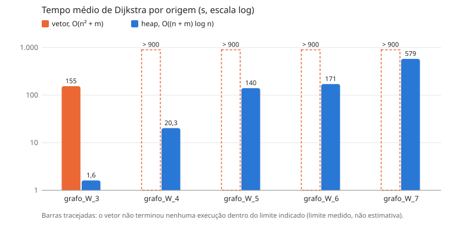
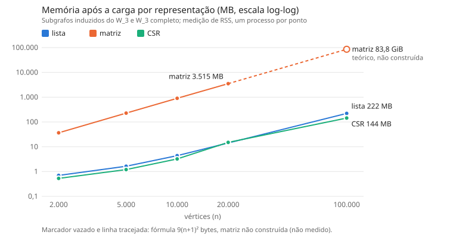

# Relatório – Trabalho de Grafos COS 242 (Parte 2)

**Dupla:** Nuno Correia e Nicolas Viana

## 1. Introdução

Estendemos a biblioteca da Parte 1 (Python 3, só a biblioteca padrão) para grafos não direcionados
com pesos reais nas arestas, com distância e caminho mínimo pelo algoritmo de Dijkstra em duas
versões: com vetor e com heap. Processamos os cinco grafos com pesos da disciplina (de 10⁵ a 5·10⁷
vértices) e a rede de colaboração. Todos os números deste relatório vêm dos arquivos em
`results/part2/`; nada foi reexecutado para escrevê-lo.

Código-fonte da biblioteca (pacote `graphs/`), dos estudos de caso (`experiments/`) e dos testes
(`tests/`): https://github.com/nunoduartte/cos242-graph

## 2. Decisões de projeto e implementação

Mantivemos a separação da Parte 1 entre **como o grafo é guardado** (`Representation`, criada por
uma fábrica e usada por composição em `Graph`) e **quais algoritmos rodam sobre ele** (Strategy).

| Módulo | Decisão principal |
|---|---|
| `representations.py` | O peso entrou na `Representation` existente: `weighted_neighbors(u)` e `weight(u, v)`; sem pesos, o peso é 1, então BFS, DFS e componentes rodam sem mudança. Três implementações: lista (um `array` de vizinhos e um de pesos por vértice), matriz (`bytearray` de presença + `array('d')` de pesos por linha, 9 bytes por célula) e **CSR** (três arrays planos: `offsets`, `targets`, `weights`; 8(n+2) + 24m bytes), nova nesta parte. |
| `priority_queues.py` | Interface `PriorityQueue` (`insert`, `decrease_key`, `pop_min`, tamanho). `VectorQueue`: vetor de estimativas, mínimo por varredura O(n). `IndexedMinHeap`: heap binário próprio com `pos[v]`, que dá `decrease_key` em O(log n) sem entradas duplicadas (o `heapq` não oferece isso). |
| `shortest_paths.py` | **Um único** `Dijkstra(queue)`: o laço de relaxamento é escrito uma vez e recebe a classe da fila. Vetor: O(n² + m); heap: O((n + m) log n). Devolve `ShortestPaths` (distâncias, pais e `path_to(v)`). Peso negativo: `NegativeWeightError`, "shortest paths with negative weights are not implemented yet". Peso zero é aceito (Dijkstra só exige w ≥ 0). |
| `graph_io.py` | Detecta a terceira coluna; peso não finito é rejeitado com o número da linha; arestas repetidas ficam com o menor peso; laços são ignorados, como na Parte 1. |

## 3. Metodologia

Seguimos a metodologia da Parte 1: **cada medição de memória roda em um processo Python separado**,
e a memória de uma estrutura é o aumento do RSS (`VmRSS` em `/proc/self/status`) entre antes e
depois de construí-la.

- **Máquina:** AMD Ryzen 7 5700X3D (L3 de 96 MiB), 31 GiB de RAM, CPython 3.14.4, Linux. Os grafos
  oficiais são lidos em CSR.
- **Tempo:** `time.perf_counter()` só em volta de `Dijkstra.run`, com o coletor de lixo pausado.
  k = 100 origens distintas sorteadas com semente 42, **as mesmas para vetor e heap**.
- **Limites:** cada execução tem até 900 s, e cada par (grafo, estratégia) tem 1.200 s de
  orçamento. Se uma execução do vetor passa de 900 s, as seguintes não rodam. Nada é extrapolado
  para preencher a tabela.
- **Pico de memória:** o kernel guarda o maior RSS (`VmHWM`); zeramos esse registro logo antes do
  trecho medido, então o pico vale mesmo para memória já liberada no fim. Subgrafos para comparar
  representações: os subgrafos do W_3 induzidos pelos vértices 1..N (N = 2.000 a 20.000).
- **Validação:** certificado de otimalidade em todas as arestas (dist[v] ≤ dist[u] + w, e igualdade
  com o pai) e comparação de todas as distâncias com a versão de vetor quando ela termina em 300 s.
  66 testes automatizados (`unittest`) comparam as duas filas com Floyd-Warshall.
- **Tipos de resultado:** *medido* (lido dos arquivos), *parcial* (menos de k execuções),
  *timeout* (interrompido no limite), *não medido*, *limite inferior* (calculado a partir de um
  timeout) e *teórico* (fórmula em n e m). Os dois últimos aparecem sempre identificados. MB = 2²⁰
  bytes.

## 4. Resultados dos estudos de caso

### 4.1 Distância e caminho mínimo de 10 até 20, 30, 40, 50 e 60 (estudo 1)

| Grafo | d(10,20) | d(10,30) | d(10,40) | d(10,50) | d(10,60) | Certificado | Vetor = heap |
|---|---|---|---|---|---|---|---|
| W_3 | 0,80 (18) | 0,89 (14) | 0,84 (10) | 0,87 (9) | 0,97 (16) | ok | sim, 10⁵ vértices |
| W_4 | 2,66 (13) | 2,02 (17) | 2,52 (15) | 2,69 (18) | 2,41 (19) | ok | vetor > 300 s |
| W_5 | 17,34 (13) | 17,24 (18) | 17,37 (14) | 15,43 (12) | 17,99 (22) | ok | vetor > 300 s |
| W_6 | 11,26 (20) | 10,67 (22) | 11,31 (11) | 9,60 (12) | 10,72 (20) | ok | vetor > 300 s |
| W_7 | 93,47 (33) | 95,08 (32) | 100,69 (46) | 95,77 (34) | 82,25 (36) | ok | vetor > 300 s |

Entre parênteses, o número de arestas do caminho. Os caminhos completos do W_3 estão abaixo; os dos
outros grafos (até 46 arestas, com rótulos de até 8 dígitos) não cabem nas 5 páginas e estão em
`results/part2/shortest_paths/table.md` no repositório.

| Destino | Distância | Caminho mínimo no W_3 |
|---|---|---|
| 20 | 0,80 | 10 → 2858 → 35293 → 3905 → 24445 → 39345 → 61279 → 41321 → 70540 → 26049 → 84450 → 68904 → 87862 → 86778 → 27694 → 16608 → 86355 → 15760 → 20 |
| 30 | 0,89 | 10 → 2858 → 35293 → 96094 → 85187 → 53177 → 64898 → 87087 → 77935 → 42304 → 78071 → 93985 → 27642 → 26151 → 30 |
| 40 | 0,84 | 10 → 2858 → 35293 → 3905 → 24445 → 86286 → 14327 → 19697 → 15930 → 46307 → 40 |
| 50 | 0,87 | 10 → 56663 → 84437 → 19040 → 82510 → 17622 → 94992 → 70948 → 19878 → 50 |
| 60 | 0,97 | 10 → 2858 → 35293 → 3905 → 24445 → 89584 → 2874 → 99253 → 66532 → 33719 → 96654 → 75728 → 79865 → 74717 → 59399 → 8718 → 60 |

### 4.2 Tabela A – Carga dos grafos (medido)

| Grafo | Vértices | Arestas | Tempo de carga (s) | Memória RSS (MB) | CSR teórico (MB) | Representação |
|---|---:|---:|---:|---:|---:|---|
| W_3 | 100.000 | 6.099.868 | 8,9 | 144 | 140 | CSR |
| W_4 | 1.000.000 | 30.999.944 | 51,4 | 745 | 717 | CSR |
| W_5 | 10.000.000 | 39.999.991 | 85,2 | 999 | 992 | CSR |
| W_6 | 10.000.000 | 73.403.372 | 142,5 | 1.756 | 1.756 | CSR |
| W_7 | 50.000.000 | 59.999.999 | 128,6 | 1.755 | 1.755 | CSR |
| Colaboração | 722.385 | 2.272.543 | 4,9 | 182 | – | lista |

### 4.3 Tabela B – Tempo médio de Dijkstra por origem (estudo 2)

| Grafo | Vértices | Arestas | Concluídas (vetor / heap) | Vetor (s) | Heap (s) | Speedup |
|---|---:|---:|---|---:|---:|---|
| W_3 | 100.000 | 6.099.868 | 7 / 100 | 154,57 | 1,61 | **96×** (medido, 7 pares) |
| W_4 | 1.000.000 | 30.999.944 | 0 / 58 | timeout > 900 | 20,31 | > 43,4× (limite inferior) |
| W_5 | 10.000.000 | 39.999.991 | 0 / 8 | timeout > 900 | 140,32 | > 6,2× (limite inferior) |
| W_6 | 10.000.000 | 73.403.372 | 0 / 6 | timeout > 900 | 171,40 | > 5,3× (limite inferior) |
| W_7 | 50.000.000 | 59.999.999 | 0 / 2 | timeout > 900 | 578,90 | > 1,6× (limite inferior) |

De k = 100 origens. Limite inferior = 900 s / tempo do heap na **mesma origem** em que o vetor
parou. Desvio-padrão do heap: 0,01 s (W_3), 1,42 s (W_4), 2,04 s (W_5), 0,41 s (W_6) e 1,27 s (W_7).

### 4.4 Tabela C – Memória adicional de Dijkstra (W_3, origem 10, processo separado)

| Grafo | Estratégia | RSS antes (MB) | Pico RSS (MB) | Aumento observado (MB) | Tempo (s) |
|---|---|---:|---:|---:|---:|
| W_3 | vetor | 162 | 167 | 4,7 | 159,36 |
| W_3 | heap | 162 | 171 | 9,1 | 1,61 |
| W_4 a W_7 | vetor e heap | – | – | não medido | – |

### 4.5 Tabela D – Lista × matriz × CSR (medido; teórico identificado)

| Grafo/subgrafo | n | m | Lista (MB) | Matriz (MB) | CSR (MB) | Pico CSR (MB) | Carga lista / matriz / CSR (s) |
|---|---:|---:|---:|---:|---:|---:|---|
| W_3, vértices 1..2.000 | 2.000 | 2.396 | 0,7 | 36,7 | 0,5 | 0,5 | 0,01 / 0,02 / 0,00 |
| W_3, vértices 1..5.000 | 5.000 | 15.033 | 1,6 | 227,7 | 1,2 | 1,1 | 0,03 / 0,15 / 0,02 |
| W_3, vértices 1..10.000 | 10.000 | 61.193 | 4,4 | 899,5 | 3,2 | 4,9 | 0,11 / 0,51 / 0,09 |
| W_3, vértices 1..20.000 | 20.000 | 244.168 | 14,2 | 3.515,4 | 15,0 | 24,1 | 0,41 / 2,12 / 0,36 |
| W_3 completo | 100.000 | 6.099.868 | 222,0 | não construída: 83,8 GiB (teórico) | 144,2 | 376,6 | 11,02 / – / 9,12 |

### 4.6 Rede de colaboração a partir de Edsger W. Dijkstra (estudo 3)

Grafo com 722.385 pesquisadores; uma execução do heap levou 3,4 s e alcançou 576.309 deles.

| Destino | Distância | Arestas | Caminho mínimo |
|---|---|---|---|
| Alan M. Turing | ∞ | – | sem caminho: a única coautoria de Turing na base é com M. H. A. Newman, e os dois formam uma componente isolada |
| J. B. Kruskal | 3,4804 | 8 | Edsger W. Dijkstra → John R. Rice → Dan C. Marinescu → Howard Jay Siegel → Edwin K. P. Chong → Ness B. Shroff → R. Srikant → Albert G. Greenberg → J. B. Kruskal |
| Jon M. Kleinberg | 2,7070 | 9 | Edsger W. Dijkstra → A. J. M. van Gasteren → Gerard Tel → Hans L. Bodlaender → Dimitrios M. Thilikos → Prabhakar Ragde → Avi Wigderson → Eli Upfal → Prabhakar Raghavan → Jon M. Kleinberg |
| Éva Tardos | 2,7535 | 11 | Edsger W. Dijkstra → A. J. M. van Gasteren → Gerard Tel → Hans L. Bodlaender → Jan van Leeuwen → Mark H. Overmars → Micha Sharir → Haim Kaplan → Robert Endre Tarjan → Andrew V. Goldberg → Serge A. Plotkin → Éva Tardos |
| Daniel R. Figueiredo | 2,9428 | 8 | Edsger W. Dijkstra → John R. Rice → Dan C. Marinescu → Chuang Lin → Bo Li → Y. Thomas Hou → Zhi-Li Zhang → Donald F. Towsley → Daniel R. Figueiredo |

## 5. Discussão e conclusão

**Ganho do heap.** No W_3, onde as duas versões terminaram, o heap foi **96 vezes** mais rápido
(154,6 s contra 1,61 s, nas mesmas 7 origens). Do W_4 em diante nenhuma execução do vetor terminou em
900 s, então só há limites inferiores, de 43× a 1,6×. Eles caem com o tamanho do grafo apenas porque
o limite é fixo e o heap fica mais lento; não indicam ganho menor. Se o vetor seguisse O(n²) com a
constante medida no W_3 (15,5 ns por n²), levaria cerca de 4,3 h no W_4, 18 dias no W_5 e no W_6 e
1,2 ano no W_7 (*estimativa teórica, não medida*). O heap concluiu 100, 58, 8, 6 e 2 das 100
execuções; o orçamento acabou antes, mas a variação foi pequena (coeficiente de variação de 0,2% a 7,0%), e as
execuções independentes do estudo 1 (origem 10) deram valores próximos: 1,6 s, 16,9 s, 138 s, 170 s
e 552 s.

**Relação com a complexidade.** O vetor faz n extrações, cada uma varrendo o vetor inteiro (`min` e
`index`, em C): 2·10¹⁰ comparações no W_3, coerente com O(n²). No heap, o tempo por unidade de
(n + m) log₂ n subiu de 15,6 ns (W_3) para 31,8 ns (W_4), 121 ns (W_5), 88 ns (W_6) e 206 ns (W_7).
Nossa interpretação (não medida): no W_3 os vetores do algoritmo (cerca de 10 MB) cabem na L3 de
96 MiB, e nos grafos de 10⁷ e 5·10⁷ vértices cada acesso aleatório a `dist`, `pos` e ao heap tende a
ir à RAM. O custo por vértice pesa mais que o custo por aresta: do W_5 para o W_6 (mesmo n), m
cresceu 1,84× e o tempo só 1,22×.

**Memória de Dijkstra.** No W_3 a chamada aumentou o RSS em 4,7 MB com vetor e 9,1 MB com heap, 3% e
6% dos 144 MB do grafo. As duas versões usam O(n) de memória extra. A diferença de 4,4 MB é da mesma
ordem da nossa estimativa para as estruturas que só o heap tem: `pos` (n + 1 referências e até n
inteiros de 28 B) e o vetor do heap (até n referências), ≈ 4,2 MB. O valor medido é do processo
inteiro e inclui o resultado (distâncias e pais), então é uma aproximação. Nos grafos maiores a
memória de Dijkstra não foi medida.

**Lista × matriz × CSR.** A matriz cresceu com n², independentemente de m: 36,7 MB com 2.000 vértices
e 3,5 GB com 20.000, de 2% a 7% acima de 9(n+1)² bytes. Com 20.000 vértices, ela também foi a mais
lenta para carregar (2,1 s, contra 0,4 s), porque aloca n² células. Lista e CSR crescem com n + m e
ficaram próximas nos subgrafos, que são esparsos. Nos menores, a medição é dominada por memória que o
alocador do Python retém (CSR com 20.000 vértices: 15,0 MB medidos, 5,7 MB teóricos). Nos grafos
inteiros a fórmula da CSR acertou: de 0% a 4% de diferença na Tabela A, e valor exato no W_6 e no W_7.
A **matriz é inviável** em todos os grafos oficiais: 83,8 GiB no W_3, 8,2 TiB no W_4, 818,5 TiB no W_5
e no W_6 e 20 PiB no W_7, contra 31 GiB de RAM. Além disso, listar os vizinhos na matriz custa O(n),
o que tornaria Dijkstra O(n²) mesmo com heap.

**CSR: menos memória final, pico maior.** No W_3 a CSR terminou com 144 MB e a lista com 222 MB (35%
a menos), mas o pico durante a construção foi de 377 MB na CSR e de 222 MB na lista. A CSR primeiro
guarda as arestas lidas (16 B por linha) e depois monta os arrays finais (24 B por aresta). Como o W_3
tem 73 arestas repetidas, a remoção de duplicatas monta uma segunda cópia enquanto as anteriores
ainda estão vivas. A nossa estimativa (16·6,1M + 2·24·6,1M + 4·8n bytes ≈ 375 MB) bate com o medido.
A lista cresce aos poucos, vértice a vértice, e não tem esse pico. Esse custo é passageiro: os
algoritmos rodam sobre os 144 MB. No W_6 e no W_7, que não têm duplicatas, não há a segunda cópia,
mas o pico não foi medido. Liberar os buffers antes da remoção de duplicatas reduziria o pico; não
implementamos.

**Arquitetura.** Como a fila é a única coisa que difere entre as duas versões de Dijkstra, os 96× do
W_3 medem só a fila: relaxamento, caminhos e validação são o mesmo código. A composição com
`Representation` permitiu acrescentar a CSR sem tocar em nenhum algoritmo e comparar as três
representações com o mesmo leitor.

**Conclusão.** O heap indexado é a única versão viável a partir de 10⁶ vértices, e a CSR é a única
representação que carregou os grafos de 10⁷ e 5·10⁷ vértices (1,0 a 1,8 GB). Ela tem o custo de um
pico de construção maior, e a lista continua competitiva em grafos pequenos. **Limitações:** Python
puro (9,6 min por origem no W_7), amostras parciais do heap nos grafos grandes, memória de Dijkstra e
pico da CSR medidos só no W_3, e caminhos mínimos com pesos negativos não implementados.
