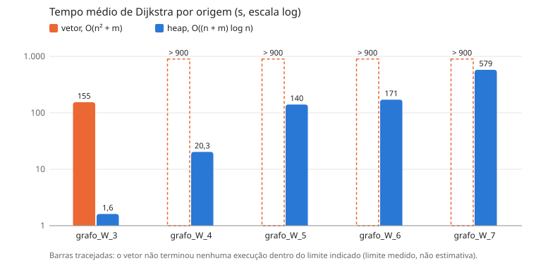
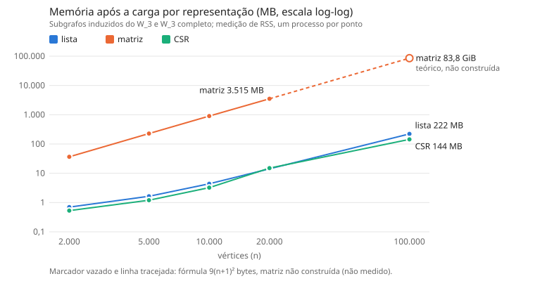
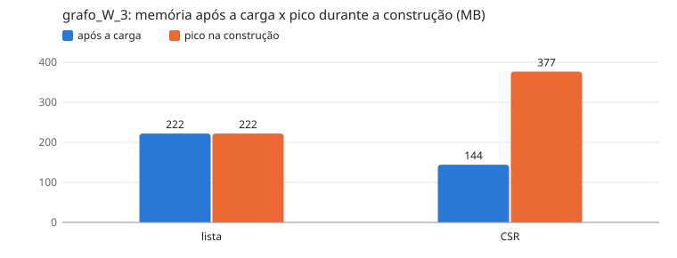

# Resultados da Parte 2 (gerado por `python -m experiments.report`)

## Estudo A: caminhos mínimos a partir do vértice 10

| Grafo | Origem | Destino | Distância | Arestas | Caminho |
|---|---|---|---|---|---|
| grafo_W_3 | 10 | 20 | 0.8 | 18 | 10 → 2858 → 35293 → 3905 → 24445 → 39345 → 61279 → 41321 → 70540 → 26049 → 84450 → 68904 → 87862 → 86778 → 27694 → 16608 → 86355 → 15760 → 20 |
| grafo_W_3 | 10 | 30 | 0.89 | 14 | 10 → 2858 → 35293 → 96094 → 85187 → 53177 → 64898 → 87087 → 77935 → 42304 → 78071 → 93985 → 27642 → 26151 → 30 |
| grafo_W_3 | 10 | 40 | 0.84 | 10 | 10 → 2858 → 35293 → 3905 → 24445 → 86286 → 14327 → 19697 → 15930 → 46307 → 40 |
| grafo_W_3 | 10 | 50 | 0.87 | 9 | 10 → 56663 → 84437 → 19040 → 82510 → 17622 → 94992 → 70948 → 19878 → 50 |
| grafo_W_3 | 10 | 60 | 0.97 | 16 | 10 → 2858 → 35293 → 3905 → 24445 → 89584 → 2874 → 99253 → 66532 → 33719 → 96654 → 75728 → 79865 → 74717 → 59399 → 8718 → 60 |
| grafo_W_4 | 10 | 20 | 2.66 | 13 | 10 → 532245 → 877016 → 554617 → 430107 → 437166 → 805646 → 841402 → 663364 → 655748 → 634947 → 318070 → 807260 → 20 |
| grafo_W_4 | 10 | 30 | 2.02 | 17 | 10 → 873980 → 182382 → 261305 → 81769 → 694525 → 219466 → 207765 → 44636 → 183747 → 920911 → 35338 → 239369 → 417194 → 132461 → 740528 → 707581 → 30 |
| grafo_W_4 | 10 | 40 | 2.52 | 15 | 10 → 873980 → 182382 → 674971 → 557022 → 188455 → 418550 → 275098 → 277633 → 801708 → 730863 → 274827 → 386086 → 188007 → 477496 → 40 |
| grafo_W_4 | 10 | 50 | 2.69 | 18 | 10 → 873980 → 182382 → 261305 → 81769 → 694525 → 382144 → 748624 → 663332 → 149827 → 349584 → 735867 → 9905 → 716970 → 472621 → 407659 → 994210 → 630598 → 50 |
| grafo_W_4 | 10 | 60 | 2.41 | 19 | 10 → 873980 → 182382 → 674971 → 106317 → 27985 → 280367 → 227336 → 364950 → 883474 → 283156 → 161217 → 224210 → 188021 → 614364 → 358029 → 855615 → 822462 → 774634 → 60 |
| grafo_W_5 | 10 | 20 | 17.34 | 13 | 10 → 7622850 → 4615833 → 6528266 → 1295458 → 7103730 → 8790605 → 7788327 → 6766415 → 7155379 → 2031914 → 3908338 → 8885874 → 20 |
| grafo_W_5 | 10 | 30 | 17.24 | 18 | 10 → 2846336 → 5413988 → 202621 → 9270546 → 6836812 → 2983314 → 8775277 → 5549785 → 3485759 → 4341576 → 8868678 → 3166991 → 5117196 → 7291082 → 1816279 → 5664093 → 8947758 → 30 |
| grafo_W_5 | 10 | 40 | 17.37 | 14 | 10 → 1299954 → 1419794 → 9885733 → 5641294 → 409605 → 4105715 → 660832 → 5850281 → 3215052 → 7676193 → 9008138 → 4846487 → 9798152 → 40 |
| grafo_W_5 | 10 | 50 | 15.43 | 12 | 10 → 1299954 → 9927727 → 8451042 → 5368621 → 4276332 → 3716282 → 3724752 → 700154 → 9271362 → 6416250 → 396789 → 50 |
| grafo_W_5 | 10 | 60 | 17.99 | 22 | 10 → 1299954 → 1419794 → 1899178 → 7524819 → 757290 → 9445351 → 9611705 → 9104671 → 8941517 → 264365 → 3945175 → 3090234 → 2071841 → 8424191 → 2860740 → 1175531 → 1925405 → 7718765 → 3193827 → 7824884 → 1454010 → 60 |
| grafo_W_6 | 10 | 20 | 11.26 | 20 | 10 → 7194590 → 1623776 → 6004729 → 5713792 → 8358296 → 2533780 → 5227148 → 8652974 → 6001519 → 3007875 → 2659882 → 1975860 → 7178227 → 4239765 → 4333977 → 5135142 → 7805172 → 6937097 → 2042733 → 20 |
| grafo_W_6 | 10 | 30 | 10.67 | 22 | 10 → 6473892 → 2441538 → 1548272 → 787618 → 5728075 → 8108429 → 6007822 → 5550988 → 2523255 → 782814 → 7306955 → 153130 → 9107012 → 8930108 → 2199545 → 9604404 → 5436447 → 8094054 → 8301086 → 7882916 → 7776260 → 30 |
| grafo_W_6 | 10 | 40 | 11.31 | 11 | 10 → 7194590 → 1308444 → 2430454 → 9006783 → 9339181 → 6729573 → 6733497 → 5619464 → 9959710 → 9649921 → 40 |
| grafo_W_6 | 10 | 50 | 9.6 | 12 | 10 → 6473892 → 2441538 → 3496708 → 8719217 → 3608871 → 1734087 → 8196874 → 3353190 → 4171489 → 6448393 → 8854015 → 50 |
| grafo_W_6 | 10 | 60 | 10.72 | 20 | 10 → 6473892 → 2441538 → 1548272 → 787618 → 9566932 → 345742 → 218396 → 8462300 → 2279724 → 9337595 → 9606830 → 9928328 → 8701739 → 8354591 → 8135590 → 4215828 → 8346899 → 3411658 → 6447603 → 60 |
| grafo_W_7 | 10 | 20 | 93.47 | 33 | 10 → 44348966 → 895015 → 41433396 → 36342079 → 15296633 → 26159915 → 16943639 → 38743389 → 10078159 → 21570419 → 11797967 → 14033688 → 15395825 → 37638078 → 10256175 → 47812933 → 16114395 → 3709139 → 16167977 → 42063355 → 25051663 → 11357393 → 1237413 → 44073100 → 46623569 → 16564439 → 33972685 → 44128375 → 38865462 → 44580311 → 49167593 → 34107790 → 20 |
| grafo_W_7 | 10 | 30 | 95.08 | 32 | 10 → 44348966 → 895015 → 41433396 → 49215936 → 31738577 → 6483504 → 6934370 → 37879154 → 8001897 → 22183730 → 7265763 → 1661582 → 11612335 → 1574885 → 30723220 → 39141968 → 27645810 → 37795681 → 33920812 → 34023581 → 12510615 → 18298407 → 31754868 → 14520632 → 7334968 → 721843 → 7608283 → 44662249 → 46198809 → 161794 → 37094018 → 30 |
| grafo_W_7 | 10 | 40 | 100.69 | 46 | 10 → 44348966 → 895015 → 41433396 → 49215936 → 31738577 → 6483504 → 35576121 → 13084740 → 8200352 → 334647 → 21020208 → 33240812 → 43511183 → 39829015 → 31993368 → 35257514 → 1449696 → 2909571 → 35131499 → 46634817 → 8774626 → 26615224 → 12496865 → 25597904 → 17624904 → 28515031 → 9039078 → 42335617 → 44883250 → 25945871 → 4357404 → 43686238 → 2293704 → 18096524 → 17747192 → 14433007 → 4134285 → 11543624 → 49518359 → 34048991 → 36125121 → 20450161 → 31315434 → 44798389 → 37766241 → 40 |
| grafo_W_7 | 10 | 50 | 95.77 | 34 | 10 → 44348966 → 895015 → 41433396 → 30012782 → 5306752 → 45425007 → 45928549 → 3090492 → 35262022 → 25302788 → 39964857 → 25438408 → 42769429 → 18259600 → 14013095 → 21407931 → 29028767 → 13632589 → 26269428 → 19841425 → 16775149 → 408668 → 33679805 → 18032133 → 15314852 → 41061763 → 21731902 → 43132195 → 43482012 → 248139 → 24050455 → 39437117 → 4560936 → 50 |
| grafo_W_7 | 10 | 60 | 82.25 | 36 | 10 → 44348966 → 895015 → 41433396 → 36342079 → 15296633 → 26159915 → 27614435 → 30636628 → 46606379 → 39970228 → 44691860 → 28472827 → 14457897 → 49527742 → 23832529 → 33803765 → 40354942 → 41967334 → 30441838 → 2384620 → 9629521 → 15597152 → 8376037 → 19638652 → 35026345 → 21270637 → 16840822 → 36015359 → 4125149 → 20825658 → 31193177 → 35236066 → 37175171 → 16297527 → 34154631 → 60 |

Validação: certificado de otimalidade em todas as arestas e comparação de todas as distâncias com o Dijkstra com vetor (quando terminou dentro do limite):

| Grafo | Certificado | Vetor x heap |
|---|---|---|
| grafo_W_3 | ok | equal |
| grafo_W_4 | ok | vector not finished in 300.0 s |
| grafo_W_5 | ok | vector not finished in 300.0 s |
| grafo_W_6 | ok | vector not finished in 300.0 s |
| grafo_W_7 | ok | vector not finished in 300.0 s |

## Estudo B: tempo médio de Dijkstra, vetor x heap

| Grafo | Vértices | Arestas | k | Vetor (ms) | Heap (ms) | Speedup |
|---|---|---|---|---|---|---|
| grafo_W_3 | 100.000 | 6.099.868 | 100 | 154 570.5 (7/100) | 1 611.1 (100/100) | 96x (7 pares) |
| grafo_W_4 | 1.000.000 | 30.999.944 | 100 | timeout (> 900 s) | 20 308.8 (58/100) | - |
| grafo_W_5 | 10.000.000 | 39.999.991 | 100 | timeout (> 900 s) | 140 322.2 (8/100) | - |
| grafo_W_6 | 10.000.000 | 73.403.372 | 100 | timeout (> 900 s) | 171 397.8 (6/100) | - |
| grafo_W_7 | 50.000.000 | 59.999.999 | 100 | timeout (> 900 s) | 578 900.1 (2/100) | - |

Entre parênteses: execuções concluídas / k. Speedup = média vetor / média heap nas origens concluídas pelas duas estratégias.

## Estudo C: rede de colaboração a partir de Edsger W. Dijkstra

| Pesquisador de origem | Pesquisador de destino | Distância | Arestas | Caminho |
|---|---|---|---|---|
| Edsger W. Dijkstra | Alan M. Turing | inalcançável | - | - |
| Edsger W. Dijkstra | J. B. Kruskal | 3.480368455 | 8 | Edsger W. Dijkstra → John R. Rice → Dan C. Marinescu → Howard Jay Siegel → Edwin K. P. Chong → Ness B. Shroff → R. Srikant → Albert G. Greenberg → J. B. Kruskal |
| Edsger W. Dijkstra | Jon M. Kleinberg | 2.706993618 | 9 | Edsger W. Dijkstra → A. J. M. van Gasteren → Gerard Tel → Hans L. Bodlaender → Dimitrios M. Thilikos → Prabhakar Ragde → Avi Wigderson → Eli Upfal → Prabhakar Raghavan → Jon M. Kleinberg |
| Edsger W. Dijkstra | Éva Tardos | 2.753514179 | 11 | Edsger W. Dijkstra → A. J. M. van Gasteren → Gerard Tel → Hans L. Bodlaender → Jan van Leeuwen → Mark H. Overmars → Micha Sharir → Haim Kaplan → Robert Endre Tarjan → Andrew V. Goldberg → Serge A. Plotkin → Éva Tardos |
| Edsger W. Dijkstra | Daniel R. Figueiredo | 2.94283087 | 8 | Edsger W. Dijkstra → John R. Rice → Dan C. Marinescu → Chuang Lin → Bo Li → Y. Thomas Hou → Zhi-Li Zhang → Donald F. Towsley → Daniel R. Figueiredo |

### Carga dos grafos (fora das medições)

| Grafo | Leitura + construção (s) | Memória (MB) |
|---|---|---|
| grafo_W_3 | 9 | 144 |
| grafo_W_4 | 51 | 745 |
| grafo_W_5 | 85 | 999 |
| grafo_W_6 | 142 | 1756 |
| grafo_W_7 | 129 | 1755 |

### Ambiente

AMD Ryzen 7 5700X3D 8-Core Processor, 30.3 GiB RAM, CPython 3.14.4, Linux-7.0.0-38-generic-x86_64-with-glibc2.43.

## Tabela A: carga dos grafos

| Grafo | Vértices | Arestas | Tempo de carga (s) | Memória RSS (MB, medido) | CSR teórico (MB) | Representação |
|---|---|---|---|---|---|---|
| grafo_W_3 | 100.000 | 6.099.868 | 8,9 | 144 | 140 | csr |
| grafo_W_4 | 1.000.000 | 30.999.944 | 51,4 | 745 | 717 | csr |
| grafo_W_5 | 10.000.000 | 39.999.991 | 85,2 | 999 | 992 | csr |
| grafo_W_6 | 10.000.000 | 73.403.372 | 142,5 | 1.756 | 1.756 | csr |
| grafo_W_7 | 50.000.000 | 59.999.999 | 128,6 | 1.755 | 1.755 | csr |
| rede_colaboracao | 722.385 | 2.272.543 | 4,9 | 182 | - | list |

Memória = RSS após a carga menos o RSS antes (medida da Parte 1). CSR teórico = 8(n+2) + 24m bytes (fórmula, não medição).

## Tabela B: desempenho de Dijkstra

| Grafo | Vértices | Arestas | Execuções concluídas (vetor/heap) | Tempo médio vetor (s) | Tempo médio heap (s) | Speedup |
|---|---|---|---|---|---|---|
| grafo_W_3 | 100.000 | 6.099.868 | 7 / 100 | 154,57 | 1,61 | 96× (medido, 7 pares) |
| grafo_W_4 | 1.000.000 | 30.999.944 | 0 / 58 | > 900 (timeout) | 20,31 | > 43,4× (limite inferior) |
| grafo_W_5 | 10.000.000 | 39.999.991 | 0 / 8 | > 900 (timeout) | 140,32 | > 6,2× (limite inferior) |
| grafo_W_6 | 10.000.000 | 73.403.372 | 0 / 6 | > 900 (timeout) | 171,40 | > 5,3× (limite inferior) |
| grafo_W_7 | 50.000.000 | 59.999.999 | 0 / 2 | > 900 (timeout) | 578,90 | > 1,6× (limite inferior) |

Execuções concluídas de k = 100 origens por estratégia. Speedup medido = média vetor / média heap nas origens concluídas pelas duas estratégias. Limite inferior = tempo em que o vetor foi interrompido / tempo do heap na mesma origem. Execuções não concluídas: o orçamento de 1.200 s por (grafo, estratégia) acabou, ou a execução anterior do vetor já tinha passado de 900 s; nenhuma foi estimada.

## Tabela C: memória adicional de Dijkstra

| Grafo | Estratégia | RSS antes (MB) | Pico RSS (MB) | Aumento observado (MB) | Tempo (s) | Status |
|---|---|---|---|---|---|---|
| grafo_W_3 | vector | 162 | 167 | 4,7 | 159,36 | ok |
| grafo_W_3 | heap | 162 | 171 | 9,1 | 1,61 | ok |
| grafo_W_4 | vetor e heap | - | - | - | - | não medido |
| grafo_W_5 | vetor e heap | - | - | - | - | não medido |
| grafo_W_6 | vetor e heap | - | - | - | - | não medido |
| grafo_W_7 | vetor e heap | - | - | - | - | não medido |

Aumento observado = pico de RSS (VmHWM zerado antes da chamada) menos o RSS antes, com o grafo já carregado. Inclui distâncias, pais e a fila; é uma aproximação do processo inteiro, não o tamanho exato das estruturas.

## Tabela D: representações

| Grafo/subgrafo | Vértices | Arestas | Representação | Tempo de carga (s) | Memória (MB) | Pico na construção (MB) | Teórico | Status |
|---|---|---|---|---|---|---|---|---|
| grafo_W_3_1-2000 | 2.000 | 2.396 | list | 0,01 | 0,7 | 0,7 | - | ok |
| grafo_W_3_1-2000 | 2.000 | 2.396 | matrix | 0,02 | 36,7 | 36,7 | 34 MB | ok |
| grafo_W_3_1-2000 | 2.000 | 2.396 | csr | 0,00 | 0,5 | 0,5 | 0,1 MB | ok |
| grafo_W_3_1-5000 | 5.000 | 15.033 | list | 0,03 | 1,6 | 1,6 | - | ok |
| grafo_W_3_1-5000 | 5.000 | 15.033 | matrix | 0,15 | 227,7 | 227,7 | 215 MB | ok |
| grafo_W_3_1-5000 | 5.000 | 15.033 | csr | 0,02 | 1,2 | 1,1 | 0,4 MB | ok |
| grafo_W_3_1-10000 | 10.000 | 61.193 | list | 0,11 | 4,4 | 4,4 | - | ok |
| grafo_W_3_1-10000 | 10.000 | 61.193 | matrix | 0,51 | 899,5 | 899,5 | 858 MB | ok |
| grafo_W_3_1-10000 | 10.000 | 61.193 | csr | 0,09 | 3,2 | 4,9 | 1,5 MB | ok |
| grafo_W_3_1-20000 | 20.000 | 244.168 | list | 0,41 | 14,2 | 14,2 | - | ok |
| grafo_W_3_1-20000 | 20.000 | 244.168 | matrix | 2,12 | 3.515,4 | 3.515,4 | 3,4 GiB | ok |
| grafo_W_3_1-20000 | 20.000 | 244.168 | csr | 0,36 | 15,0 | 24,1 | 5,7 MB | ok |
| grafo_W_3 | 100.000 | 6.099.868 | list | 11,02 | 222,0 | 222,0 | - | ok |
| grafo_W_3 | 100.000 | - | matrix | - | - | - | 83,8 GiB | not built: needs ~83.8 GiB > --matrix-max-gb |
| grafo_W_3 | 100.000 | 6.099.868 | csr | 9,12 | 144,2 | 376,6 | 140,4 MB | ok |

Subgrafo `_1-N` = subgrafo do W_3 induzido pelos vértices 1..N. Memória = RSS após a carga menos o RSS antes; pico = maior RSS durante leitura + construção menos o mesmo ponto. Teórico: matriz 9(n+1)² bytes, CSR 8(n+2) + 24m bytes.

### Matriz nos grafos completos

| Grafo | Vértices | Matriz com pesos (teórico) | Situação |
|---|---|---|---|
| grafo_W_3 | 100.000 | 83,8 GiB | não construída |
| grafo_W_4 | 1.000.000 | 8,2 TiB | não construída |
| grafo_W_5 | 10.000.000 | 818,5 TiB | não construída |
| grafo_W_6 | 10.000.000 | 818,5 TiB | não construída |
| grafo_W_7 | 50.000.000 | 20,0 PiB | não construída |

9(n+1)² bytes (fórmula, não medição).

### Medições incompletas

- grafo_W_3: vetor 7/100, heap 100/100 execuções concluídas.
- grafo_W_4: vetor 0/100, heap 58/100 execuções concluídas.
- grafo_W_5: vetor 0/100, heap 8/100 execuções concluídas.
- grafo_W_6: vetor 0/100, heap 6/100 execuções concluídas.
- grafo_W_7: vetor 0/100, heap 2/100 execuções concluídas.
