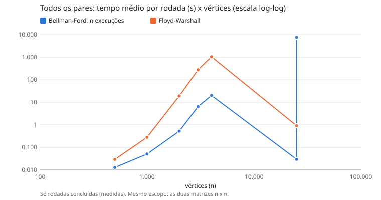

# Parte 3 — resultados consolidados
Gerado a partir de `results/part3/`; nada foi recalculado. Distâncias com duas casas (os pesos têm duas). −∞: o vértice alcança um ciclo negativo que alcança o destino.

## 1. Bellman-Ford: distância de 10, 20 e 30 até 100

| Grafo | Origem | Destino | Distância | Arestas | Status | Caminho |
|---|---|---|---|---|---|---|
| grafo_W_1 | 10 | 100 | −∞ (ciclo negativo) | - | ciclo negativo no caminho (distância −∞) | - |
| grafo_W_1 | 20 | 100 | −∞ (ciclo negativo) | - | ciclo negativo no caminho (distância −∞) | - |
| grafo_W_1 | 30 | 100 | −∞ (ciclo negativo) | - | ciclo negativo no caminho (distância −∞) | - |
| grafo_W_2 | 10 | 100 | 10,47 | 11 | ok | 10 → 22754 → 23713 → 20821 → 23161 → 3591 → 7214 → 4808 → 7704 → 10831 → 14144 → 100 |
| grafo_W_2 | 20 | 100 | 8,48 | 6 | ok | 20 → 6795 → 7737 → 11988 → 7094 → 14144 → 100 |
| grafo_W_2 | 30 | 100 | 8,71 | 11 | ok | 30 → 23783 → 439 → 502 → 7344 → 7842 → 10419 → 12598 → 13685 → 17695 → 14144 → 100 |
| grafo_W_3 | 10 | 100 | 4,63 | 8 | ok | 10 → 2858 → 9370 → 31488 → 43785 → 48833 → 70398 → 74552 → 100 |
| grafo_W_3 | 20 | 100 | 5,42 | 8 | ok | 20 → 2526 → 8495 → 13021 → 15939 → 20244 → 36899 → 74552 → 100 |
| grafo_W_3 | 30 | 100 | 4,67 | 7 | ok | 30 → 29698 → 43059 → 43482 → 35741 → 74494 → 74552 → 100 |
| grafo_W_4 | 10 | 100 | 9,04 | 13 | ok | 10 → 91829 → 417272 → 775161 → 842600 → 906821 → 930962 → 994427 → 321645 → 620573 → 21519 → 43375 → 351045 → 100 |
| grafo_W_4 | 20 | 100 | 8,83 | 11 | ok | 20 → 775000 → 859374 → 148050 → 161821 → 274264 → 315038 → 749181 → 51701 → 83053 → 351045 → 100 |
| grafo_W_4 | 30 | 100 | 9,23 | 14 | ok | 30 → 124400 → 225008 → 352692 → 424754 → 485462 → 502763 → 926624 → 80691 → 571210 → 620573 → 21519 → 43375 → 351045 → 100 |
| grafo_W_5 | 10 | 100 | 37,85 | 22 | ok | 10 → 8226464 → 8398644 → 9402245 → 9739987 → 937849 → 597353 → 2241769 → 3118871 → 5374339 → 319782 → 1409550 → 8063679 → 4187984 → 8322144 → 7915275 → 1116679 → 8592040 → 9168609 → 1011134 → 617312 → 4484876 → 100 |
| grafo_W_5 | 20 | 100 | 42,63 | 22 | ok | 20 → 8885874 → 9172974 → 190993 → 901806 → 2122291 → 7949832 → 4297068 → 9799215 → 4313 → 6690018 → 2041796 → 8483311 → 4418352 → 4580063 → 8048493 → 5653904 → 8592040 → 9168609 → 1011134 → 617312 → 4484876 → 100 |
| grafo_W_5 | 30 | 100 | 37,86 | 30 | ok | 30 → 792746 → 8357921 → 3360862 → 7413679 → 787170 → 3097792 → 4607918 → 7198627 → 9170278 → 9726068 → 2117603 → 4473017 → 7399377 → 1303598 → 5096941 → 9492473 → 2243408 → 3162255 → 9430472 → 706910 → 7918231 → 9767508 → 600132 → 2212225 → 6106658 → 9336327 → 69858 → 617312 → 4484876 → 100 |

| Grafo | n | m | Arestas negativas | Ciclo negativo até o destino | Ciclo negativo no grafo | Rodadas | Relaxamentos | Tempo (s) | Validação |
|---|---|---|---|---|---|---|---|---|---|
| grafo_W_1 | 25000 | 549953 | 4998 | sim (2 arestas, peso -2,61) | sim (2 arestas, peso -2,63) | 4 | 16884 | 0.19 | - |
| grafo_W_2 | 25000 | 824964 | 0 | não | não | 24 | 2811818 | 0.51 | certificado ok, Dijkstra ok |
| grafo_W_3 | 100000 | 6099941 | 0 | não | não | 25 | 24981367 | 4.21 | certificado ok, Dijkstra ok |
| grafo_W_4 | 1000000 | 30999978 | 0 | não | não | 36 | 148909037 | 36.81 | certificado ok, Dijkstra ok |
| grafo_W_5 | 10000000 | 39999995 | 0 | não | não | 42 | 115672017 | 97.69 | certificado ok, Dijkstra ok |

## 2. Floyd-Warshall: distâncias entre {10, 20, 30, 40, 50}

**grafo_W_1** — linha = origem, coluna = destino; calculado com Bellman-Ford (Floyd-Warshall: negative cycle)

| de \ para | 10 | 20 | 30 | 40 | 50 |
|---|---|---|---|---|---|
| **10** | −∞ (ciclo negativo) | −∞ (ciclo negativo) | −∞ (ciclo negativo) | −∞ (ciclo negativo) | −∞ (ciclo negativo) |
| **20** | −∞ (ciclo negativo) | −∞ (ciclo negativo) | −∞ (ciclo negativo) | −∞ (ciclo negativo) | −∞ (ciclo negativo) |
| **30** | −∞ (ciclo negativo) | −∞ (ciclo negativo) | −∞ (ciclo negativo) | −∞ (ciclo negativo) | −∞ (ciclo negativo) |
| **40** | −∞ (ciclo negativo) | −∞ (ciclo negativo) | −∞ (ciclo negativo) | −∞ (ciclo negativo) | −∞ (ciclo negativo) |
| **50** | −∞ (ciclo negativo) | −∞ (ciclo negativo) | −∞ (ciclo negativo) | −∞ (ciclo negativo) | −∞ (ciclo negativo) |

**grafo_W_2** — linha = origem, coluna = destino; calculado com Floyd-Warshall (estudo 3, rodada 0 (results/part3/benchmark/grafo_W_2.json); pares iguais em 10/10 rodadas)

| de \ para | 10 | 20 | 30 | 40 | 50 |
|---|---|---|---|---|---|
| **10** | 0,00 | 11,73 | 8,14 | 9,49 | 7,08 |
| **20** | 3,84 | 0,00 | 7,03 | 8,30 | 4,70 |
| **30** | 5,79 | 12,55 | 0,00 | 8,30 | 6,33 |
| **40** | 5,05 | 12,32 | 5,36 | 0,00 | 5,71 |
| **50** | 4,48 | 12,23 | 7,79 | 8,26 | 0,00 |

**grafo_W_3** — linha = origem, coluna = destino; calculado com Bellman-Ford (Floyd-Warshall: não executado: n = 100000 exige 111.8 GiB nas duas matrizes (limites: 16 GiB, 25000 vértices))

| de \ para | 10 | 20 | 30 | 40 | 50 |
|---|---|---|---|---|---|
| **10** | 0,00 | 4,99 | 5,71 | 7,49 | 4,31 |
| **20** | 3,48 | 0,00 | 6,19 | 8,27 | 4,32 |
| **30** | 3,96 | 5,80 | 0,00 | 8,30 | 3,17 |
| **40** | 3,58 | 5,59 | 6,10 | 0,00 | 3,84 |
| **50** | 3,25 | 5,41 | 6,12 | 8,10 | 0,00 |

**grafo_W_4** — linha = origem, coluna = destino; calculado com Bellman-Ford (Floyd-Warshall: não executado: n = 1000000 exige 11,175.9 GiB nas duas matrizes (limites: 16 GiB, 25000 vértices))

| de \ para | 10 | 20 | 30 | 40 | 50 |
|---|---|---|---|---|---|
| **10** | 0,00 | 10,52 | 10,15 | 10,69 | 8,24 |
| **20** | 7,79 | 0,00 | 9,19 | 9,67 | 7,58 |
| **30** | 7,61 | 10,25 | 0,00 | 8,77 | 6,55 |
| **40** | 7,94 | 8,65 | 9,22 | 0,00 | 7,75 |
| **50** | 7,99 | 11,41 | 8,80 | 8,55 | 0,00 |

**grafo_W_5** — linha = origem, coluna = destino; calculado com Bellman-Ford (Floyd-Warshall: não executado: n = 10000000 exige 1,117,587.3 GiB nas duas matrizes (limites: 16 GiB, 25000 vértices))

| de \ para | 10 | 20 | 30 | 40 | 50 |
|---|---|---|---|---|---|
| **10** | 0,00 | 40,20 | 39,56 | 41,55 | 44,91 |
| **20** | 39,17 | 0,00 | 39,98 | 49,82 | 45,16 |
| **30** | 34,46 | 42,64 | 0,00 | 47,04 | 43,85 |
| **40** | 38,73 | 43,91 | 47,30 | 0,00 | 45,24 |
| **50** | 44,06 | 40,62 | 45,25 | 49,11 | 0,00 |

| Grafo | n | Matrizes (GiB) | Floyd-Warshall | Tempo FW (s) | Etapa k alcançada | Ciclo negativo |
|---|---|---|---|---|---|---|
| grafo_W_1 | 25000 | 6.99 | negative cycle | 0.9 | 2 | sim (2 arestas, etapa k = 2) |
| grafo_W_2 | 25000 | 6.99 | ok | 2760.2 | 25000 | - |
| grafo_W_3 | 100000 | 111.76 | não executado: n = 100000 exige 111.8 GiB nas duas matrizes (limites: 16 GiB, 25000 vértices) | - | - | - |
| grafo_W_4 | 1000000 | 11175.89 | não executado: n = 1000000 exige 11,175.9 GiB nas duas matrizes (limites: 16 GiB, 25000 vértices) | - | - | - |
| grafo_W_5 | 10000000 | 1117587.31 | não executado: n = 10000000 exige 1,117,587.3 GiB nas duas matrizes (limites: 16 GiB, 25000 vértices) | - | - | - |

## 3. Tempo médio em 10 rodadas

| Grafo | n | m | Bellman-Ford até o destino (s) | Floyd-Warshall (s) |
|---|---|---|---|---|
| grafo_W_1 | 25000 | 549953 | 0.1909 ± 0.0012 (10/10) | 0.9098 ± 0.0032 (10/10) |
| grafo_W_2 | 25000 | 824964 | 0.5117 ± 0.0027 (10/10) | 2735.9881 ± 8.6573 (10/10) |
| grafo_W_3 | 100000 | 6099941 | 4.2049 ± 0.0387 (10/10) | refused: n = 100000 needs 111.8 GiB for the matrices (limits 16 GiB, 25000 vertices) |
| grafo_W_4 | 1000000 | 30999978 | 36.4215 ± 0.1478 (10/10) | refused: n = 1000000 needs 11,175.9 GiB for the matrices (limits 16 GiB, 25000 vertices) |
| grafo_W_5 | 10000000 | 39999995 | 97.2871 ± 0.4251 (10/10) | refused: n = 10000000 needs 1,117,587.3 GiB for the matrices (limits 16 GiB, 25000 vertices) |

grafo_W_2: distâncias e caminhos do estudo 2 iguais nas 10 rodadas do Floyd-Warshall: sim

Média ± desvio-padrão amostral das rodadas concluídas (concluídas/rodadas). Escopos diferentes: Bellman-Ford calcula as distâncias de todos os vértices até um destino; Floyd-Warshall, todos os pares.

## 4. Bellman-Ford para todos os pares x Floyd-Warshall

| Grafo | n | m | Bellman-Ford, todos os pares (s) | Floyd-Warshall (s) | FW / BF | Mesmas distâncias |
|---|---|---|---|---|---|---|
| grafo_W_1 | 25000 | 549953 | 0.0296 ± 0.0002 (10/10) | 0.9098 ± 0.0032 (10/10) | 30.69 | - |
| grafo_W_2 | 25000 | 824964 | 7600.7415 (1/1) | não executado | - | - |
| grafo_W_2_1-1000 | 1000 | 1291 | 0.0505 ± 0.0009 (10/10) | 0.2801 ± 0.0019 (10/10) | 5.54 | sim |
| grafo_W_2_1-2000 | 2000 | 5360 | 0.5214 ± 0.0026 (10/10) | 19.0694 ± 0.2520 (10/10) | 36.57 | sim |
| grafo_W_2_1-3000 | 3000 | 11973 | 6.4328 ± 0.0439 (10/10) | 277.5182 ± 1.8611 (10/10) | 43.14 | sim |
| grafo_W_2_1-4000 | 4000 | 21171 | 20.0368 ± 0.1763 (10/10) | 1043.4855 ± 47.7235 (10/10) | 52.08 | sim |
| grafo_W_2_1-500 | 500 | 307 | 0.0128 ± 0.0001 (10/10) | 0.0291 ± 0.0003 (10/10) | 2.27 | sim |

Média ± desvio-padrão amostral das rodadas concluídas (concluídas/rodadas). Mesmo escopo: matriz n x n de distâncias e de predecessores. Estimativas, não medições: extrapolação (Bellman-Ford) = tempo até a interrupção x n / origens concluídas; limite superior (Floyd-Warshall) = tempo até a interrupção + etapas restantes x (n - 1) linhas x (n + 1) células x custo por célula medido.

